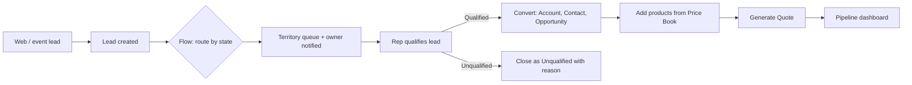

# Salesforce CRM Lead-to-Quote Implementation

A business analysis and configuration project in Salesforce Sales Cloud, built in a Salesforce Developer org during my M.S. in Management Information Systems at the University at Buffalo.

**Scenario:** *BrightDesk Office Solutions* (a fictional B2B office-furniture supplier) tracked leads in spreadsheets and email. Leads went unanswered for days, nobody knew which rep owned which lead, and quotes were built by hand in Word. My job was to analyze the current process, define the requirements, and configure Sales Cloud to cover the full journey from lead capture to quote.

**Tools:** Salesforce Sales Cloud, Flow Builder, Lightning App Builder, Reports & Dashboards, Visio-style process maps (Mermaid)

## What I delivered

| BA deliverable | File |
|---|---|
| Business requirements (BRD) | [docs/01_business_requirements.md](docs/01_business_requirements.md) |
| As-is and to-be process flows | [docs/02_process_flows.md](docs/02_process_flows.md) |
| User stories and acceptance criteria | [docs/03_user_stories.md](docs/03_user_stories.md) |
| Data model and field definitions | [docs/04_data_model.md](docs/04_data_model.md) |
| Flow automation design | [docs/05_flow_design.md](docs/05_flow_design.md) |
| Reports and dashboard specification | [docs/06_reports_dashboards.md](docs/06_reports_dashboards.md) |
| UAT test cases | [docs/07_uat_test_cases.md](docs/07_uat_test_cases.md) |
| Requirements traceability matrix | [docs/08_traceability_matrix.md](docs/08_traceability_matrix.md) |

## What I configured in Salesforce

- **Lead capture and qualification:** a custom Lead Rating score and qualification fields, plus required-field validation rules
- **Lead routing:** a record-triggered Flow assigns each new lead to a territory queue by state and notifies the owner
- **Conversion:** lead fields map to Account, Contact, and Opportunity on conversion
- **Opportunity and quote tracking:** sales stages with stage-based validation, Products and Price Books, and Quotes generated from Opportunities
- **Reports and dashboards:** pipeline by stage, lead conversion rate by source, lead response time, and quotes by status

## Lead-to-quote flow

## Screenshots

Screenshots of the org configuration are in [`screenshots/`](screenshots/).
