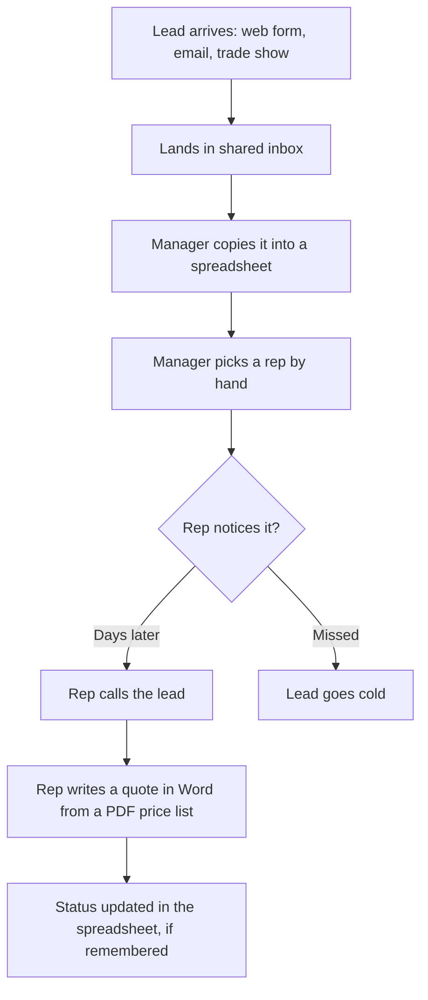
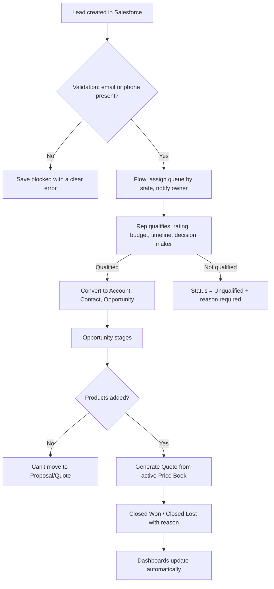

# Process Flows

## As-is (before Salesforce)

**Pain points**
1. Manual assignment delays first contact (sometimes by days).
2. No single owner, so leads get missed.
3. Old price lists cause quoting errors.
4. The manager has to chase reps for pipeline updates.
5. No data on which lead sources convert.

## To-be (Salesforce Sales Cloud)

## Gap analysis

| Area | As-is | To-be | Gap closed by |
|---|---|---|---|
| Lead ownership | Assigned by hand | Automatic by state | Record-triggered Flow + queues |
| Data quality | Free-form spreadsheet | Required fields and picklists | Validation rules, picklists |
| Quoting | Word + PDF price list | Quote from Price Book | Products, Price Books, Quotes |
| Visibility | Asking each rep | Live dashboards | Reports & Dashboards |
| Source ROI | Unknown | Conversion by source | Lead Source field + report |
