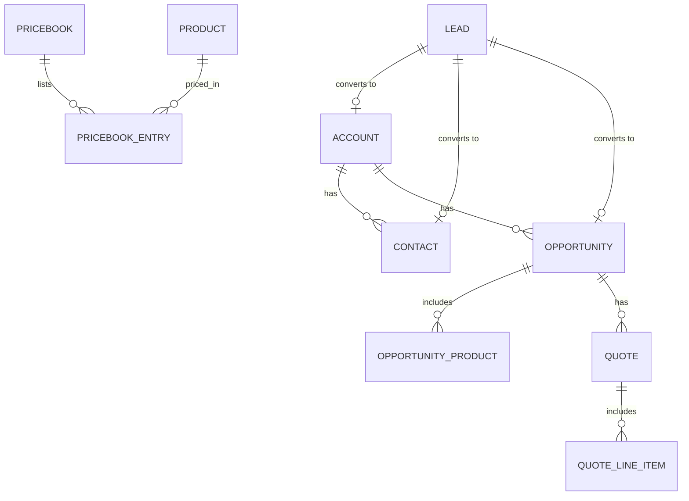

# Data Model and Field Definitions

## Objects

## Custom and key fields

| Object | Field | Type | Values / rule | Requirement |
|---|---|---|---|---|
| Lead | Lead Rating | Picklist | Hot, Warm, Cold | FR-05 |
| Lead | Product Interest | Picklist | Desks, Seating, Storage, Conference | FR-01 |
| Lead | Budget Confirmed | Checkbox | | FR-05 |
| Lead | Timeline | Picklist | < 1 month, 1–3 months, 3–6 months, 6+ months | FR-05 |
| Lead | Decision Maker | Checkbox | | FR-05 |
| Lead | Unqualified Reason | Picklist | No budget, No need, Competitor, Unresponsive | FR-06 |
| Lead | First Response Hours | Number (Flow-set) | Hours from creation to first status change | OBJ-2 |
| Opportunity | Product Interest | Picklist | Mapped from Lead | FR-07 |
| Opportunity | Lead Rating | Picklist | Mapped from Lead | FR-07 |
| Opportunity | Loss Reason | Picklist | Price, Timing, Competitor, No decision | FR-11 |

## Validation rules

| Name | Object | Logic (summary) | Error message |
|---|---|---|---|
| Require_Contact_Method | Lead | `ISBLANK(Email) && ISBLANK(Phone)` | Enter an email or phone number. |
| Require_Unqualified_Reason | Lead | `ISPICKVAL(Status,"Unqualified") && ISBLANK(TEXT(Unqualified_Reason__c))` | Select an Unqualified Reason. |
| Require_Loss_Reason | Opportunity | `ISPICKVAL(StageName,"Closed Lost") && ISBLANK(TEXT(Loss_Reason__c))` | Select a Loss Reason. |
| Products_Before_Quote | Opportunity | `ISPICKVAL(StageName,"Proposal/Quote") && HasOpportunityLineItem = FALSE` | Add at least one product before quoting. |

## Lead conversion mapping

| Lead field | Maps to |
|---|---|
| Company | Account Name |
| First / Last Name, Email, Phone | Contact |
| Product Interest | Opportunity.Product Interest |
| Lead Rating | Opportunity.Lead Rating |
| Lead Source | Opportunity.Lead Source (standard) |
