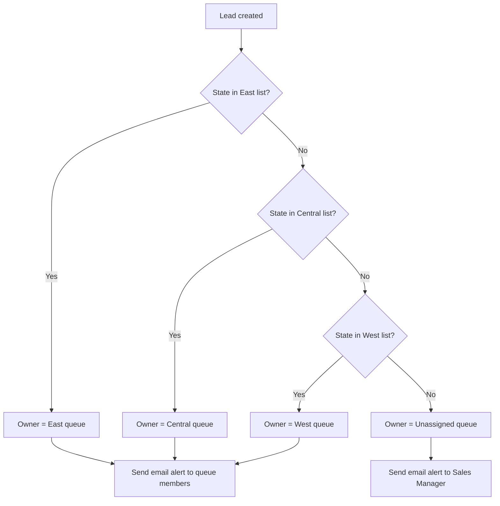

# Flow Design: Lead Routing

**Flow name:** Lead_Route_By_Territory
**Type:** Record-triggered Flow (after save)
**Trigger:** Lead is created

## Territory mapping

| Queue | States |
|---|---|
| East | NY, NJ, PA, MA, CT, RI, VT, NH, ME, MD, DE, DC, VA, NC, SC, GA, FL |
| Central | TX, IL, OH, MI, IN, WI, MN, IA, MO, KS, NE, OK, ND, SD, TN, KY, AL, MS, LA, AR |
| West | CA, WA, OR, NV, AZ, UT, CO, NM, ID, MT, WY, AK, HI |
| Unassigned | State is blank or not recognized |

## Logic

## Design decisions

- **Why queues and not individual reps?** The team is small, and reps cover for each other. With queues, any rep in the territory can claim a lead, and nothing depends on one person being available.
- **Why a Flow and not legacy assignment rules?** Flow is Salesforce's current automation tool. It also lets one automation handle both the assignment and the notification, and it's easier to extend later (for example, round-robin within a queue).
- **Why an Unassigned queue?** Leads with bad or missing state data still get an owner (the manager) instead of being silently dropped.

## Second flow: First Response Hours

**Flow name:** Lead_Set_First_Response
**Trigger:** A Lead is updated, Status changes away from "Open – Not Contacted", and First Response Hours is blank.
**Action:** Sets First Response Hours = (NOW() − CreatedDate) × 24. The response-time report uses this field.
